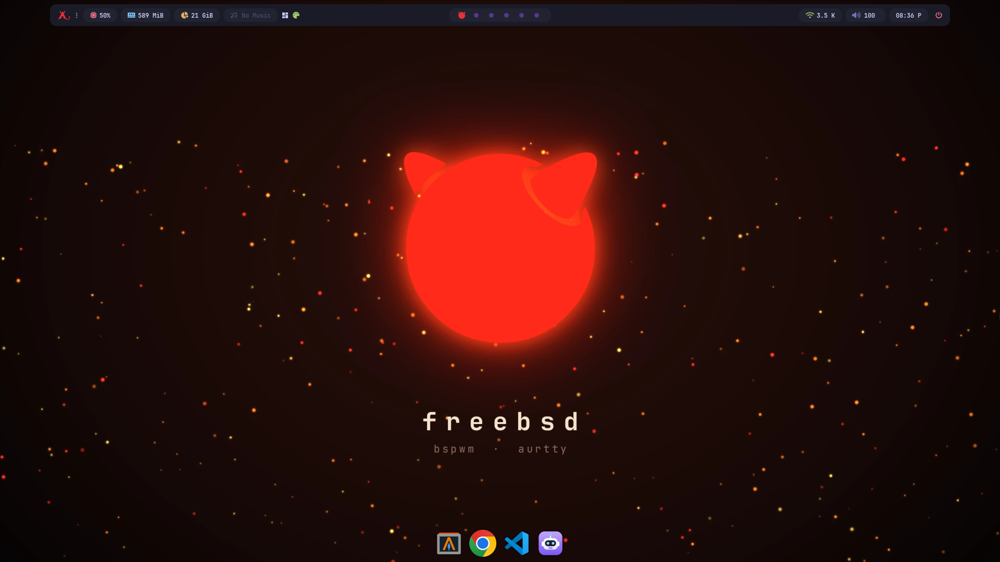
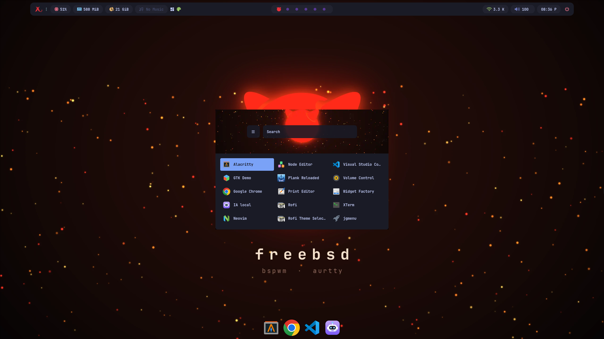
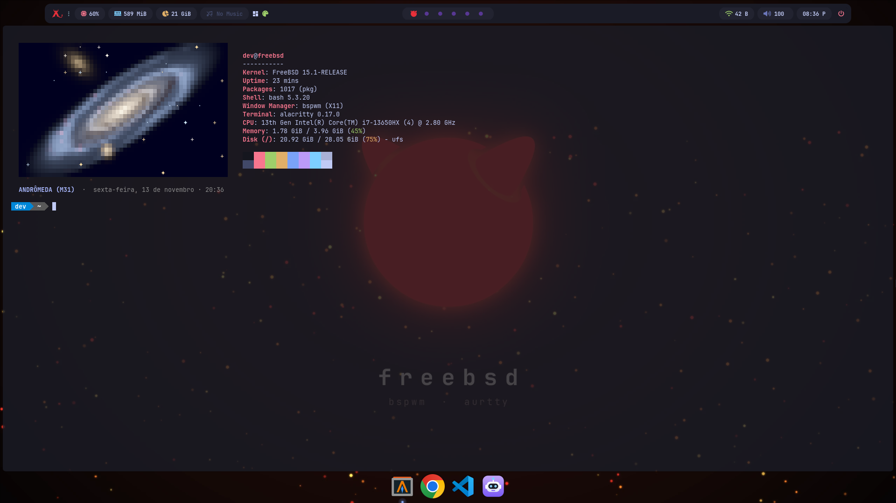

# freebsd-bspwm-aurtty

Pós-instalação do **FreeBSD** que deixa a máquina pronta para desenvolver: **bspwm** com
visual Tokyo Night, tela de login gráfica, terminal configurado, Firefox, PCManFM,
ferramentas de backend e AstroNvim (Neovim).

Você instala um FreeBSD limpo, clona este repositório, roda um script, responde
algumas perguntas e entra direto no bspwm.

## Capturas

Tiradas numa VM (QEMU, 1920x1080, sem aceleração de vídeo) logo depois de rodar o instalador.

**Tela de login** (LightDM com o tema `AurTTY-Login`)


**Área de trabalho** (polybar `bar07` em cima)


**Menu de aplicativos** (`super+espaço`)


**Terminal** (saudação do universo sorteada a cada terminal, com as informações do sistema ao lado)


## Instalação

Num FreeBSD 14 ou 15 recém-instalado, como `root`:

```sh
pkg install -y git
git clone https://github.com/RobertoBarbosa-AurTTY/freebsd-bspwm-aurtty
cd freebsd-bspwm-aurtty
sh install.sh
```

O script pergunta:

| Pergunta | Padrão |
|---|---|
| Usuário (existente ou novo) | — |
| Layout do teclado | `br` (ABNT2) |
| Driver de vídeo: VM com BIOS (vesa), UEFI sem driver (scfb), Intel/AMD (drm-kmod), NVIDIA | detecta VM, BIOS ou UEFI |
| Como entrar: tela de login gráfica (LightDM), login no `ttyv0` abrindo o bspwm, ou manual (`startx`) | LightDM |
| Terminal estilo AurTTY: bash + oh-my-bash (powerline) + ble.sh como shell padrão | sim |
| Ferramentas de desenvolvimento backend | sim |

O log fica em `/var/log/freebsd-bspwm-aurtty.log`. As configs que já existiam em
`~/.config` são movidas para `~/.config-backup-<data>`.

## O que é instalado

- **Janela/barra:** bspwm, sxhkd, polybar (`bar07`), picom, rofi, dunst, jgmenu, alacritty
- **Navegador e arquivos:** Firefox (`super+b`) e PCManFM, o gerenciador de arquivos (`super+f`)
- **Editor:** AstroNvim, a configuração do Neovim em `~/.config/nvim` (os plugins são
  baixados na primeira execução do `nvim`)
- **Aparência:** tema GTK `TokyoNight-zk`, ícones `TokyoNight-SE`, cursor `Qogirr-Dark`,
  JetBrainsMono Nerd Font, FontAwesome, Material Design Icons, wallpapers do Emilia
- **Sistema:** Xorg, dbus, pulseaudio, driver de vídeo escolhido
- **Tela de login (opcional, padrão):** LightDM com tema próprio `AurTTY-Login` (`extras/lightdm/gtk.css`,
  sobre o TokyoNight-zk): cartão translúcido arredondado, campos e botão no azul do Emilia,
  avatar redondo com o diabinho do ArchBSD (`extras/lightdm/avatar.png`), wallpaper FreeBSD dark
  e a sessão `bspwm (AurTTY)`. Config em
  `/usr/local/etc/lightdm/lightdm-gtk-greeter.conf`.
- **Terminal (opcional):** bash, oh-my-bash com tema powerline, ble.sh (realce e sugestões),
  eza (`ls`/`ll`/`lt` com ícones), zoxide e fzf (`Ctrl+R` histórico, `Ctrl+T` arquivos).
  **fzf-tab**: o `TAB` abre o fzf com pré-visualização (pastas com eza, arquivos com bat),
  no mesmo estilo do fzf-tab do zsh do gh0stzk ([fzf-tab-completion](https://github.com/lincheney/fzf-tab-completion)).
  O `.bashrc` fica em `extras/bash/bashrc`; `rr` reinicia o terminal limpo.
  **Saudação do universo:** cada terminal novo sorteia uma figura desenhada em blocos coloridos,
  Andrômeda (M31), Pilares da Criação (M16), o buraco negro TON 618, a Nebulosa do Caranguejo
  (M1) com o pulsar girando, o Homúnculo de Eta Carinae, a hipergigante VY Canis Majoris
  com a superfície fervendo, Júpiter com as luas de Galileu, Marte com Fobos, Saturno com os
  anéis ou o "planeta de diamante" 55 Cancri e (os planetas giram), com o nome e a data
  embaixo e, ao lado, as informações do sistema (fastfetch, no estilo do neofetch); em todas,
  menos no TON 618, a figura se mexe até o primeiro comando. São procedurais
  (`extras/bash/universo/*/render.py`, sem fotos) e os quadros já vêm prontos. `figura off`
  para a animação; no `.bashrc`, `FIGURA_FIXA=caranguejo` (nome da pasta) fixa uma figura,
  `FIGURA=0` desliga a saudação e `FIGURA_INFO=0`, só as informações.
- **Desenvolvimento backend (opcional):** lazygit, tmux, gh, mise
  (versões de linguagem por projeto, já ativado no `.bashrc`), uv, yq, xh, httpie, python3,
  node22 + npm, deno, sqlite3, clientes de PostgreSQL (`psql`, `pgcli`), MariaDB/MySQL e
  Valkey (`valkey-cli`, compatível com Redis), shellcheck e pre-commit. Docker não existe no
  FreeBSD; no lugar dele vem o **`devdb`**, que sobe bancos de desenvolvimento em jails:
  ```sh
  devdb criar postgres     # ou mysql, valkey (Redis), mongo
  devdb lista              # bancos e estado
  devdb parar|iniciar|shell|apagar <banco>
  ```
  Cada banco roda numa jail própria (Bastille, jail "thin"), isolada do sistema mas usando a
  rede do computador: conecta em `127.0.0.1` na porta padrão (Postgres: usuário `postgres` sem
  senha; MySQL: `dev`/`dev`). As jails voltam sozinhas no boot. Pede a senha do root.
- **`atualizar`:** atualiza o FreeBSD e os pacotes de uma vez. Com o sistema em **ZFS**, tira
  antes uma cópia do sistema inteiro (boot environment); se algo quebrar, `atualizar --voltar`
  e `reboot` voltam tudo como estava (ou escolha a cópia `antes-<data>` no menu do boot, opção 8).
  Guarda as 5 cópias mais recentes. Em UFS atualiza sem cópia, avisando antes. Para ter o
  desfazer, escolha ZFS na instalação do FreeBSD.
- Temas e fontes externos são baixados com **sha256 fixado** (veja o topo do `install.sh`)

## Atalhos principais

| Atalho | Ação |
|---|---|
| `super + Return` | terminal |
| `super + space` | lançador (rofi) |
| `super + b` | Firefox |
| `super + f` | PCManFM |
| `alt + F1` | lista de atalhos |
| `super + 1..9` | áreas de trabalho |
| `super + x` | fechar janela |
| `super + Escape` | recarregar atalhos (sxhkd) |

## Diferenças em relação ao original (Arch)

- Só o tema **Emilia** e a barra **bar07**. O seletor de temas existe, mas tem uma opção só.
- Sem **eww**, que não tem pacote no FreeBSD: os widgets de perfil e do player não abrem.
- Módulos da barra removidos: bateria e bluetooth (leem `/sys` do Linux), atualizações (pacman).
- Wallpapers próprios (`extras/walls/`, gerados por `tools/gerar-wallpapers.py`):
  **FreeBSD dark** (padrão) e uma **homenagem ao ArchBSD/PacBSD**. Os do Emilia continuam
  disponíveis no seletor (`super + alt + w`).
- Paleta opcional de **fogo** para a barra (`extras/polybar/fogo.ini`), desligada por padrão.
  Para ativar, troque `include-file = ../colors.ini` por `include-file = fogo.ini` em
  `~/.config/bspwm/bars/bar07/config.ini`.
- Área de trabalho ativa: logo do **FreeBSD** (glifo `nf-linux-freebsd` da Nerd Font) no lugar do pacman.
- Ícone do launcher: logo inspirado no **ArchBSD** (o Arch vermelho com chifres e rabo de diabinho),
  numa fonte própria (`extras/fonts/AurTTYIcons.otf`, gerada por `tools/gerar-icone-archbsd.py`).
  A cor fica em `arch_icon` no `theme-config.bash` do Emilia.
- `freebsd-bin/`: pequenos *shims* para os scripts do tema, que esperam ferramentas GNU/Linux
  (`sed`→`gsed`, `stat`/`date`/`shuf` do coreutils, `pidof` e `ip route` emulados).
  Eles ficam no início do `PATH` da sessão bspwm.

## Manutenção

`dotfiles/` é gerado, não editado à mão:

```sh
tools/sincronizar-upstream.sh            # commit fixado em UPSTREAM
tools/sincronizar-upstream.sh <commit>   # atualizar para outro commit do projeto original
```

O script baixa o upstream, mantém só o Emilia e aplica as adaptações para FreeBSD.

## Créditos e licença

O visual (configurações do bspwm, polybar, rofi, dunst e picom, scripts, temas GTK, ícones,
cursor e wallpapers do tema Emilia) vem dos **[dotfiles do gh0stzk](https://github.com/gh0stzk/dotfiles)**,
publicados sob GPL-3.0. Os arquivos copiados de lá ficam em `dotfiles/` com os cabeçalhos
originais; as adaptações para FreeBSD são aplicadas por `tools/sincronizar-upstream.sh`.
Ícone do launcher: releitura do logo do ArchBSD/PacBSD sobre o glifo `arch` do
Material Design Icons (Apache-2.0).
Este projeto é um derivado e segue a mesma licença, **GPL-3.0** (veja `LICENSE`).
